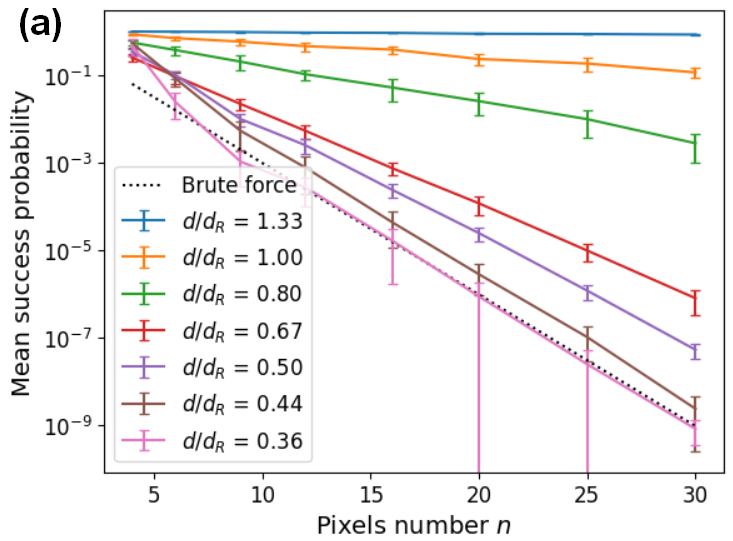
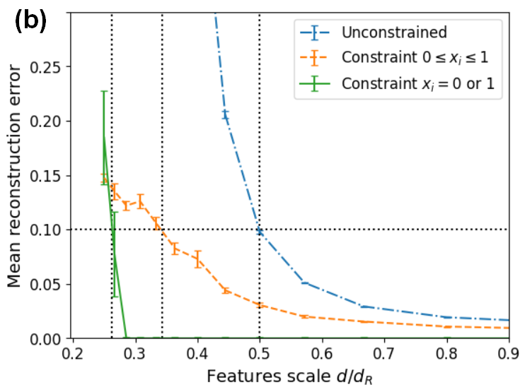

Quantum microscopy includes a number of techniques that provide superresolution (overcoming the classical Rayleigh limit) by exploiting quantum states of light and measuring photon correlations. Besides the resolution enhancement due to quantum correlations, there exists an additional resource — the presence of a priori information about the object under study. A significant additional increase in practically achievable resolution due to the use of natural physical constraints on the transmission amplitude of the observed object $0\le A(\vec r) \le 1$ was experimentally discovered in [[1]](#ref1), and was theoretically explained and quantitatively described in a recent paper [[2]](#ref2). It is logical to assume that even more stringent — binary — constraints $(A(\vec r) = 0$ or $1)$ will lead to an even stronger increase in resolution.

Generally speaking, for efficient information extraction from correlation images of quantum microscopy, it is not sufficient to simply identify the image with the object under study (as assumed in the Rayleigh criterion) — a special procedure for reconstructing the object is required, based, for example, on the maximum likelihood method [[1,2,3]](#ref1). For the commonly considered case of reconstructing the transmission function in terms of continuous variables $(A(\vec r) \in [0, 1])$, there are a number of efficient optimization methods, including gradient algorithms. In contrast, the binary optimization problem for $A(\vec r) =0$ or 1 is a computationally complex combinatorial problem and, in a general case, requires enumerating $2^n$ possible images for an object parameterized by $n$ pixels.

In this contribution, we propose a method for solving this problem on a quantum computer. Specifically, the problem belongs to the class of quantum unconstrained binary optimization (QUBO). For such problems, the quantum approximate optimization algorithm (QAOA) [[4]](#ref4) is applied, and its efficiency is significantly increased when using the fixed-point version of QAOA (fpQAOA). The idea behind fpQAOA is in the universality of the optimal set of QAOA parameters (Hamiltonian switching schedule) for similar problems. This enables the selection of optimal parameters based on a training set of relatively simple problems (for which the "barren plateaus" effect is still weak) and then use in solving complex, higher-dimensional problems.

In this contribution, we demonstrate the applicability of fpQAOA to binary quantum microscopy. The results presented in [Figure 1(a)](#fig-results) confirm the validity of the hypothesis of the universality of the QAOA parameters for the problem of object reconstruction in binary quantum microscopy (which is not necessarily true for an arbitrary QUBO problem). They show that for features of size $d \gtrsim d_\text{R}$ ($d_\text{R}$ is the resolution limit without constraints for this quantum microscopy problem – the generalized Rayleigh limit), reconstruction with fpQAOA is more efficient than a simple enumeration. [Figure 1(b)](#fig-results) demonstrates an emulation of the application of this method to the reconstruction of a $5\times 5$ pixel object with subsequent evaluation of the achievable resolution. One can see that binary constraints indeed allow one to increase the resolution by more than 20% compared to the constraints $0 \le A(\vec r) \le 1$ and by almost 2 times compared to the unconstrained problem.

<figure style="text-align: center;">

   
  

<figcaption style="font-size: 0.95em; margin: 15px auto 0 auto; max-width: 90%; text-align: justify;"> Figure 1. Application of fpQAOA to binary quantum imaging: (a) one-run success probability for universal parameters for given relative pixel size and (b) dependence of the mean reconstruction error on the spatial scale of object features.
</figcaption>
</figure>

Despite the improved efficiency of object reconstruction using the fpQAOA method compared to brute-force search, the exponential increase of problem complexity with the number of pixels representing the object still remains ([Figure 1(a)](#fig-results)). In this study, we demonstrate a combination of the sliding window method [[1]](#ref1) with fpQAOA. This achieves linear scaling of the analysis time with the size (number of pixels) of a large object (with retention of the exponential dependence on the number of pixels in the spot of the effective point-spread function).

This work was supported by BRFFR project F26RNF-169 and Belarussian state program “Convergence”.

## References

1. A. Mikhalychev et al., Nat.Commun. **1**, 134 (2019).
2. A. Mikhalychev et al., Phys. Rev. A **3**, 032618.
3. A. Mikhalychev et al., npj Quantum Information **1**, 125 (2021).
4. E. Farhi et al., arXiv preprint arXiv:1411.4028 (2014).
